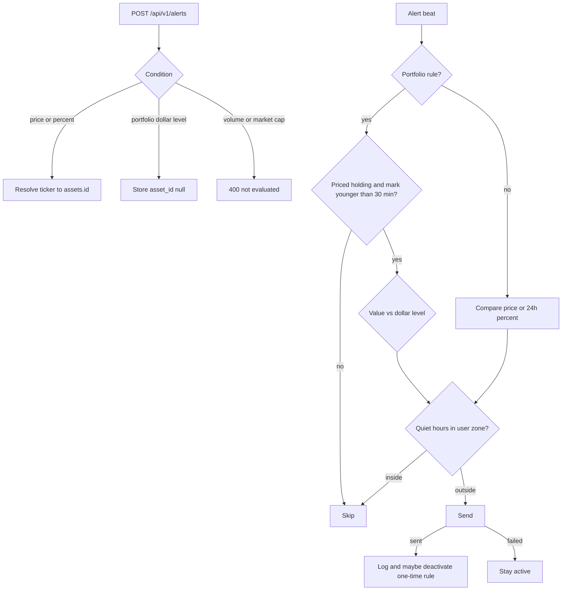

# Portfolio value alerts and quiet-hour clocks

## Purpose

Fire an alert when the virtual portfolio's marked value crosses a dollar level the user set, and suppress alerts during the quiet hours on that user's clock.

## Scope

- Create: `PORTFOLIO_VALUE_UP` and `PORTFOLIO_VALUE_DOWN` on `POST /api/v1/alerts`.
- Evaluate: Celery alert worker reads `portfolios.current_value` after the portfolio job has priced at least one holding.
- Quiet hours: compare `users.quiet_hours_start` / `quiet_hours_end` to `users.time_zone`, not UTC.
- Out of scope: volume and market-cap conditions (still rejected). This is not a broker and does not place trades.

## Inputs and outputs

| Input | Output |
|---|---|
| Condition `portfolio_value_up` or `portfolio_value_down`, threshold in dollars, no asset id | Alert row with `asset_id` null |
| Portfolio `current_value`, priced holdings, `last_calculated_at` | Send or skip |
| `time_zone` plus quiet-hour window | Suppress or deliver |

## Dependencies

- Portfolio worker (`update_all_portfolios`, every 5 minutes) writes marks.
- Existing notification channels (email, push, SMS, call).
- `zoneinfo` for the user timezone. An unknown zone falls back to UTC.

## Functional flow

## Failure paths

- No portfolio, no priced holding, or a mark older than 30 minutes: the rule stays active and does not send. A missing quote is not treated as a portfolio worth $0.
- Negative threshold: 400.
- Unknown timezone string: quiet hours use UTC.
- Failed email or SMS: the one-time rule stays armed.

## Security considerations

- The rule is scoped to `alert.user_id`. Another user's book is never read for the comparison.
- Email copy states the figure is the virtual book the user entered, not a trade instruction.
- No new secrets. Thresholds are numeric.

## Performance considerations

- One portfolio row and its holdings are loaded per portfolio rule per pass. Holdings are not re-priced in the alert task; that stays on the 5-minute portfolio job.
- Stale marks are skipped so a stuck job cannot notify on an old total.
